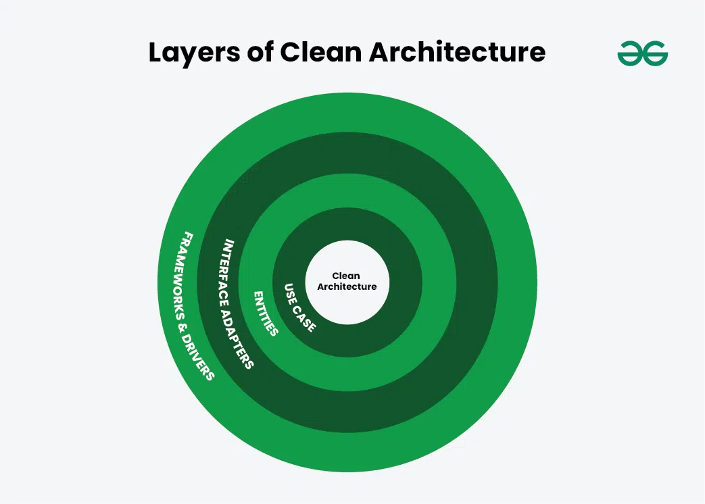

# Lineamientos del proyecto

## Tecnologías a usar

### Frontend

- **Next.js + TypeScript 7.**
- **Shadcn para el front** (nos permite usar componentes ya hechos y enfocarnos más en la lógica que en la UI).
- Para la representación de cosas más complejas, como un mapa o calle, no descartar el uso de otras librerías open source.

### Backend (Python)

- **FastAPI**, ya que si bien Flask es más amigable para iniciar, FastAPI es una librería estándar en el desarrollo backend en Python, además de que genera documentación automática de los endpoints.
- **MySQL** (no nos interesa utilizar un ORM; si hay DB, es mínima).

## Modelo a elegir

A definir según el TP elegido.

## Dataset a usar

A definir según el TP elegido.

## Herramientas de procesamiento de datos

A definir según el TP elegido.

## Herramientas de IA que usamos

- Pi Harness.
- Diversos LLM open source.
- GPT 6.1, Sol, Luna 6.

## Arquitectura del proyecto

Crearemos un skill específico para determinar el tipo de arquitectura que queremos para el proyecto, de forma que escalarlo y testearlo sea mucho más sencillo.

Propongo un estilo de arquitectura del tipo *Clean Architecture*, siguiendo los principios SOLID.

Además, crear una API del tipo REST:

- https://learn.microsoft.com/en-us/azure/architecture/best-practices/api-design
- https://www.geeksforgeeks.org/system-design/complete-guide-to-clean-architecture/

Una arquitectura de este estilo nos permitiría crear una capa de abstracción tal que podríamos testear distintos modelos hasta encontrar el adecuado, sin cambiar la lógica de negocio.

