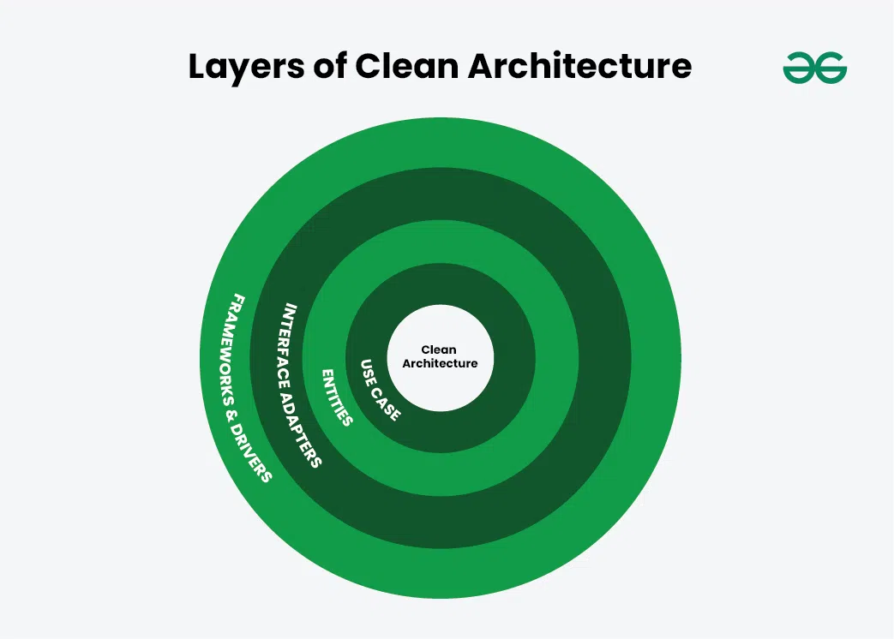

# Lineamientos del proyecto

## Tecnologías a usar

### Frontend

- **Next.js + TypeScript 7.**
- **Shadcn para el front** (nos permite usar componentes ya hechos y enfocarnos más en la lógica que en la UI).
- Para la representación de cosas más complejas, como un mapa o calle, no descartar el uso de otras librerías open source.

### Backend (Python)

- **FastAPI**, ya que si bien Flask es más amigable para iniciar, FastAPI es una librería estándar en el desarrollo backend en Python, además de que genera documentación automática de los endpoints. FastAPI expone preparación, modelo y grafos por API; no es fuente de datos.
- **Datos: CSV + pandas + scikit-learn** (stack del curso Intro-A-ML, sesiones 1–5: `Intro-A-ML/requirements.txt` trae solo numpy, pandas, matplotlib, scikit-learn, jupyterlab, ipykernel). Sin DB en v1; si el día de mañana hace falta persistencia mínima, SQLite vía pandas alcanza. **Sin SQLAlchemy / sin ORM / sin MySQL en el camino crítico**: el curso no usa SQLAlchemy en ningún lado y este TP no lo necesita.

## Modelo a elegir

Clasificación de prioridad por tramo (`baja` / `media` / `alta`) con scikit-learn (stack del curso Intro-A-ML, sesiones 1–5): `DecisionTreeClassifier` vs al menos otro (`LogisticRegression` / `KNeighborsClassifier` / `SVC`), con `make_pipeline` + `StandardScaler` donde aplique y validación cruzada. Detalle en `PLAN.md`.

## Dataset a usar

Dataset mixto v1 en zona piloto de Montevideo (diseño v2): geometría IDE + contenedores BasuraCero/Figshare + `dias` real + `quejas` reales + `tipo_zona` única simulada + etiqueta construida v1. Definición en `docs/dataset-recoleccion.md` y `dataset/README.md`; la construcción reproducible es del issue #9.

## Herramientas de procesamiento de datos

CSV + pandas + scikit-learn (+ matplotlib para exploración). Sin SQLAlchemy / sin ORM / sin MySQL en el camino crítico; FastAPI solo expone el modelo por API, sin DB en v1.

## Herramientas de IA que usamos

- Pi Harness.
- Diversos LLM open source.
- GPT 6.1, Sol, Luna 6.

## Arquitectura del proyecto

Crearemos un skill específico para determinar el tipo de arquitectura que queremos para el proyecto, de forma que escalarlo y testearlo sea mucho más sencillo.

Propongo un estilo de arquitectura del tipo *Clean Architecture*, siguiendo los principios SOLID.

Además, crear una API del tipo REST:

- https://learn.microsoft.com/en-us/azure/architecture/best-practices/api-design
- https://www.geeksforgeeks.org/system-design/complete-guide-to-clean-architecture/

Una arquitectura de este estilo nos permitiría crear una capa de abstracción tal que podríamos testear distintos modelos hasta encontrar el adecuado, sin cambiar la lógica de negocio.

Debemos pensar una vez seleccionado el tp, el HLD y LLD, de forma que podramos establecer un norte y crear los diferentes issues.

